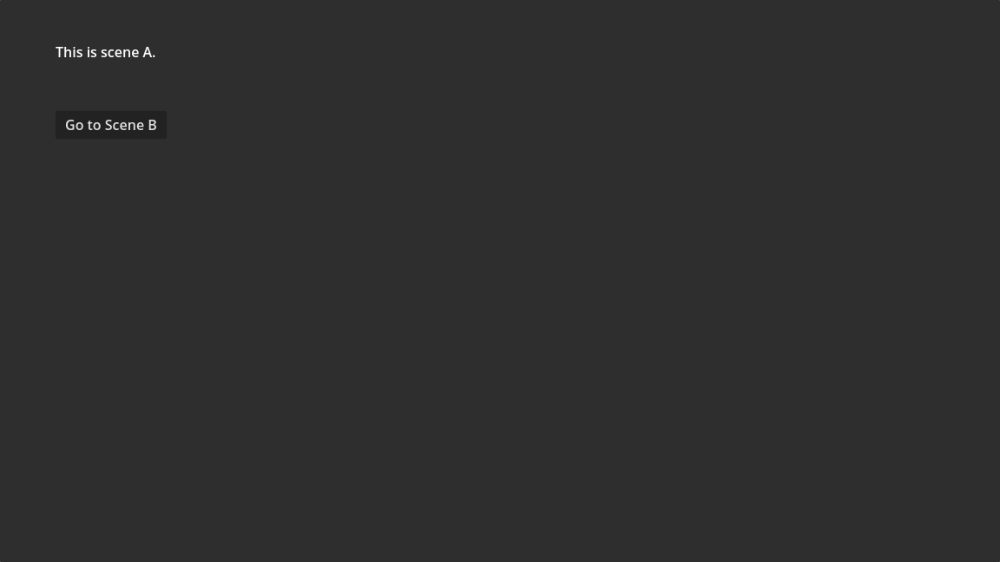

# Autoload Demo

This demo shows was built on top of https://godotengine.org/asset-library/asset/529 to show to use autoloads to change between scenes and custom resources to store data.

Language: GDScript

Renderer: Compatibility

## Screenshots

